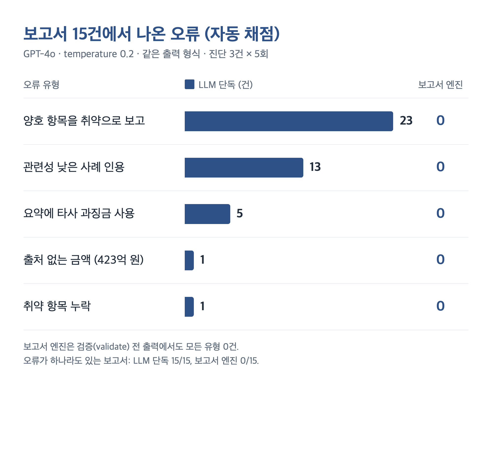
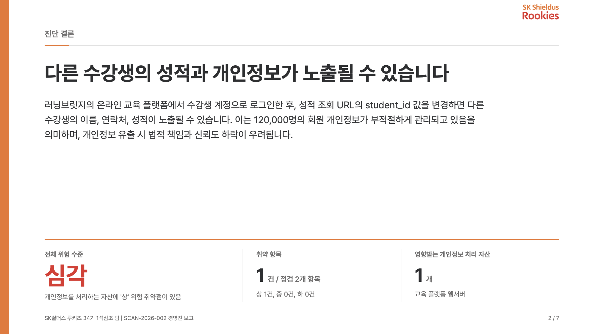
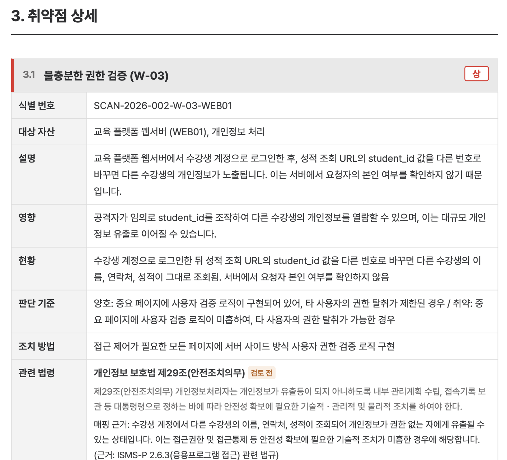

# 에듀 체크 (EduCheck)

**생성형 AI를 활용한 개인정보 유출 취약점 자동 진단 및 ISMS-P 인증기준 확인**
SK 루키즈 34기 모듈 프로젝트 2 · 2026.10.01 ~ 10.07 · 7인 팀

> 원본 레포: [unble-SH/34_module_proj2](https://github.com/unble-SH/34_module_proj2) · 이 레포는 포트폴리오용 포크입니다.

URL 하나를 입력하면 교육 플랫폼의 개인정보 유출 관련 웹 취약점 5개 영역을 자동 진단하고, 결과를 ISMS-P 인증기준·개인정보 보호법 조문에 매핑한 뒤, **경영진용 요약 보고서와 실무진용 상세 보고서(PDF 2종)** 를 생성합니다.

```
main.py ─▶ 스캐너 5종 ─▶ 법령·ISMS-P 매핑 ─▶ 보고서 엔진 ─▶ PDF 2종
           (scanner/)     (legal_module/)     (report_engine/)
```

| 디렉터리 | 내용 |
|---|---|
| `web_service/` | 진단 대상 교육 관리 플랫폼 (Flask, 학생·강사 계정, 성적, 문의 게시판) |
| `vuln_assessment/scanner/` | 정보 누출 · 약한 비밀번호 정책 · 취약한 비밀번호 복구 · 불충분한 인증 · 불충분한 권한 검증 |
| `vuln_assessment/legal_module/` | 진단 결과 → ISMS-P 인증기준 · 개인정보 보호법 조문·항 매핑 (LLM + 닫힌 목록 검증) |
| `vuln_assessment/report_engine/` | 진단 JSON → 경영진용·실무진용 보고서 PDF |

---

## 내 역할: 보고서 엔진 (`vuln_assessment/report_engine/`)

보고서 모듈(엔진, 사례 지식베이스) 설계·구현과 발표를 맡았습니다.

**핵심 원칙 — 판정은 코드, 문장은 AI, 숫자·조문·조치 방법은 원본 데이터**

LLM에게 보고서를 통째로 맡기면 과징금 금액을 잘못 옮기고, 없는 조문·사례를 인용하고, 양호 항목을 취약으로 보고했습니다. 그래서 LLM이 판단해서는 안 되는 것을 코드로 분리했습니다.

| 단계 | 처리 | 내용 |
|---|---|---|
| ① 판정 | 코드 | 취약 통계, 전체 위험 수준, 유사 사례 검색, 과징금 노출액, 조치 우선순위 계산 |
| ② 문장 | LLM 1회 | 판정이 끝난 사실만 넘겨 결론·핵심 위험·조치 로드맵 문장 작성 (원화 금액은 넘기지 않음) |
| ③ 검증 | 코드 | 없는 취약점·조문·사례 ID 제거, 후보 밖 사례 인용 차단, 로드맵 누락 항목 보완, 금액 문구 경고 |
| ④ 렌더링 | 코드 | 같은 데이터 → Jinja2 템플릿 2종 → WeasyPrint PDF |

- **사례 지식베이스(RAG)**: 개인정보위 처분 보도자료 15건 → 사례 카드 30장. 임베딩 + ChromaDB로 검색하고 *동일 결함 / 같은 유형 / 관련 통제 / 참고* 4단계 등급을 매겨, '참고' 등급은 인용하지 못하게 했습니다.
- **과징금 노출액**: 2026.9 시행 개정 개인정보 보호법 기준(매출 3% 상한, 감경 40%·30%)으로 코드가 계산하고 유사 처분액 분포를 함께 표시합니다.
- **기술 스택**: Python 3.12 · OpenAI GPT-4o (temperature 0.2, JSON 모드) · text-embedding-3-small · ChromaDB · Jinja2 · WeasyPrint

### 검증 결과 — LLM 단독 vs 보고서 엔진 (진단 3건 × 5회, GPT-4o)

| 지표 | LLM 단독 | 보고서 엔진 |
|---|---|---|
| 오류가 있는 보고서 | 15 / 15 | **0 / 15** |
| 양호 항목 오보 | 22건 | **0건** |
| 관련성 낮은 사례 인용 | 11건 | **0건** |
| 요약 속 과징금 금액 | 8건 | **0건** |
| 입력 토큰 | 8,580 | **4,923 (−43%)** |

- 가짜 ID·금액 등 오류 8종을 일부러 주입한 시험에서 8종 모두 탐지·제거·경고
- 보고서 1건 생성 평균 10.5초 (최소 7.0초 ~ 최대 16.0초)



실험 스크립트와 원본 결과는 [experiment/](experiment/README.md)에 있고, 자세한 설계는 [보고서 엔진 모듈 설명](docs/report_engine_module.md)에 정리했습니다.

---

## 결과물

| 자료 | 링크 |
|---|---|
| 경영진용 보고서 샘플 (16:9) | [exec_report.pdf](docs/sample_reports/exec_report.pdf) |
| 실무진용 상세 보고서 샘플 (A4) | [tech_report.pdf](docs/sample_reports/tech_report.pdf) |
| 팀 최종 발표 | [PDF](docs/presentation/educheck_team_presentation.pdf) · [PPTX](docs/presentation/educheck_team_presentation.pptx) |
| 보고서 엔진 발표 | [PDF](docs/presentation/report_engine_presentation.pdf) · [PPTX](docs/presentation/report_engine_presentation.pptx) |

샘플 보고서는 2026-10-07 통합 실행(`SCAN-20261007-002`) 결과이며, 고객사 정보는 가상의 교육 플랫폼 기준입니다.

| 경영진용 — 진단 결론 | 실무진용 — 취약점 상세 |
|---|---|
|  |  |

---

## 실행

```bash
pip install -r requirements.txt
cp vuln_assessment/report_engine/.env.example vuln_assessment/.env   # OPENAI_API_KEY 입력
```

대상 웹 서비스 실행, 스캐너 통합 실행, 보고서 생성 방법은 각 모듈의 README를 참고하세요.
- [vuln_assessment/README.md](vuln_assessment/README.md)
- [vuln_assessment/report_engine/README.md](vuln_assessment/report_engine/README.md)
